<div align="center">

# 🔍 비드체크 · BidCheck

**나라장터 입찰 공고 참가자격 판정 · 변경공고 대응 서비스**

회사 정보를 기준으로 공고의 참가자격을 원문 근거와 함께 판정하고,<br/>공고가 바뀌면 달라진 요건만 다시 확인합니다.

`SK Networks Family AI Camp 34기` &nbsp;·&nbsp; `4차 프로젝트` &nbsp;·&nbsp; `4팀`

<br/>


</div>

<details>
<summary><b>목차</b></summary>

<br>

- [프로젝트 한눈에 보기](#프로젝트-한눈에-보기)
- [1. 팀 소개](#-1-팀-소개)
- [2. 프로젝트 개요](#-2-프로젝트-개요)
- [3. 기술 스택](#️-3-기술-스택)
- [4. WBS](#-4-wbs)
- [5. 요구사항 정의서](#-5-요구사항-정의서)
- [6. ERD](#️-6-erd)
- [7. 시스템 구성도와 주요 처리 흐름](#-7-시스템-구성도와-주요-처리-흐름)
- [8. 화면 설계](#️-8-화면-설계)
- [9. 수행결과 (테스트 및 시연 화면)](#-9-수행결과-테스트-및-시연-화면)
- [트러블슈팅](#-트러블슈팅)
- [현재 한계와 다음 개선](#-현재-한계와-다음-개선)
- [10. 한 줄 회고](#-10-한-줄-회고)

</details>

---

## 프로젝트 한눈에 보기

| 질문 | 답변 |
| --- | --- |
| 어떤 문제를 푸나요? | 나라장터 공고마다 다르게 적힌 참가자격을 회사 정보와 대조해, 참가할 수 있는 공고인지와 그 근거를 보여 줍니다. 공고가 바뀌면 무엇이 달라졌는지 먼저 보여 줍니다. |
| LLM은 어디에 쓰나요? | 공고문(내부에 저장한 문서)에서 자격 요건을 구조화하고, 공고문을 근거로 질문에 답합니다(AI Copilot). |
| 최종 판정은 누가 하나요? | 구조화된 요건과 회사 프로필을 **코드(결정론적 규칙)** 로 비교합니다. 근거 문장이 저장된 공고문에 없으면 판정하지 않고 "확인 필요"로 남깁니다. |
| 3차 프로젝트와 무엇이 다른가요? | 엔진을 DB·API와 분리해 다시 세웠고, 판정 정확도를 실제 공고 표본으로 재며 고쳤습니다. 요금제·한도, AWS 배포, AI Copilot 자유 대화, 사업자등록번호 조회, 입찰 준비 지침서, 회원가입을 더했습니다. |

### 핵심 결과

| 항목 | 결과 |
| --- | --- |
| 골든 회귀(판정 규칙) | 138행 중 기대값 일치 **105** · 안전한 보류 **33** · 잘못된 확정 판정 **0** |
| 실제 공고 정답 표본 | 공고 **104건** 기준 핵심 요건 **192 / 198** 일치 · 틀린 충족·틀린 미충족 **0** |
| 제품 경로와 엔진의 일치 | 골든 계정 32개로 화면에서 판정한 결과가 엔진 회귀 결과와 요건 **104 / 104** 동일 |
| 자동 테스트 | API **1,022** · 엔진 **626** · 측정 **63** · 웹 단위 **47** · 브라우저 E2E **23** |
| 수집 데이터(로컬 기준) | 공고 약 **7,700건** (2026-10-14) |
| 배포 | AWS(EC2 · RDS · S3 · ECR) · GitHub Actions 자동 배포 |

---

## 👥 1. 팀 소개

**팀명** 사고치지마

| 팀원 | 김재현 | 👑이홍규 | 전진환 | 정예린 | 황수빈 |
| --- | --- | --- | --- | --- | --- |
| 사진 |  |  |  |  |  |
| GitHub | [@kim-4480](https://github.com/kim-4480) | [@4hglee-ops](https://github.com/4hglee-ops) | [@dfs32dfs](https://github.com/dfs32dfs) | [@yerin816](https://github.com/yerin816) | [@subinss838](https://github.com/subinss838) |
| 주요 담당 | LLM / RAG · Requirement<br>Extraction ·<br>Evaluation | Team Lead · AI Copilot<br>· Product Integration ·<br>Collaboration & Workflow | Backend · API ·<br>전체 시스템 구성 | DataBase ·<br>Data Collection /<br>Management | 기획 · Frontend · UI/UX |

### 협업 방식

| 항목 | 내용 |
| --- | --- |
| 개발 흐름 | `Issue → Branch → Pull Request → CI → Merge`. `develop`에 병합되고 CI가 통과하면 AWS에 자동 배포됩니다. |
| 영역 분리 | 웹(`apps/web`) · API(`apps/api`) · 엔진(`engine`) · 측정(`eval`)으로 나누고, PR이 어느 영역을 바꾸는지 `Zone guard`가 알려 줍니다. |
| 품질 게이트 | PR마다 엔진·측정·백엔드·프론트·통합 다섯 검사를 돌립니다. 판정 규칙이 바뀌면 골든 회귀가 "잘못된 확정 판정 0"을 지키는지 확인합니다. |
| DB 변경 | 마이그레이션은 자동으로 적용하지 않습니다. 배포 전에 DB 버전과 코드가 맞는지 검사하고, 다르면 배포를 멈추고 이전 버전으로 되돌립니다. |

---

## 📌 2. 프로젝트 개요

### 프로젝트 명

**비드체크(BidCheck)** — 나라장터 입찰 공고 참가자격 판정 · 변경공고 대응 서비스

### 프로젝트 소개

입찰 담당자가 공고를 열 때 가장 먼저 확인하는 것은 "우리 회사가 이 입찰에 참가할 수 있는가"입니다. 비드체크는 나라장터에서 공고와 첨부 문서를 수집하고, LLM으로 공고문에서 참가자격 요건을 뽑아 구조화한 뒤, 회사 프로필과 코드로 비교해 **충족 · 미충족 · 확인 필요**를 요건마다 보여 줍니다. 판정마다 근거가 된 공고문 문장을 함께 보여 주고, 공고가 변경되면 달라진 값과 요건을 먼저 보여 줍니다.

```
공고 수집 → 첨부 추출 → 요건 구조화(LLM) → 근거 확인 → 판정(코드) → 화면 · AI Copilot
                                                      ↑
                                              회사 프로필(업종 · 소재지 · 기업 구분 · 실적 · 인증)
```

### 프로젝트 필요성(배경)

- **공고마다 형식이 다릅니다.** 참가자격은 표준 공고문, 제안요청서, 과업지시서 등에 흩어져 있고, 기관마다 적는 방식이 다릅니다. 담당자는 공고 하나를 볼 때마다 첨부를 열어 직접 찾아야 합니다.
- **변경공고를 놓치기 쉽습니다.** 마감일·금액·자격 요건이 바뀌어도 무엇이 바뀌었는지 한눈에 알려 주는 곳이 없습니다. 이미 준비한 입찰이 바뀐 조건에서도 유효한지 다시 확인해야 합니다.
- **틀린 판정의 비용이 큽니다.** 자격이 되는데 "안 된다"고 하면 기회를 잃고, 안 되는데 "된다"고 하면 준비 비용을 날립니다. 그래서 확실하지 않으면 판정하지 않는 쪽을 택했습니다.

### 프로젝트 목표

| 목표 | 달성 기준 |
| --- | --- |
| 근거가 있는 판정 | 모든 판정에 공고문 인용 문장을 붙이고, 인용이 저장된 문서에 없으면 "확인 필요"로 남긴다 |
| 틀린 확정 판정 0 | 골든 회귀와 실제 공고 표본에서 틀린 충족·틀린 미충족이 없다 |
| 변경공고 대응 | 차수 사이에 달라진 공고 값과 자격 요건을 화면 맨 위에 보여 준다 |
| 문서 기반 질의응답 | 공고문과 판정 결과를 근거로 질문에 답하고, 근거가 없으면 답하지 않는다 |
| 클라우드 배포 | AWS에 배포하고, 병합부터 배포까지 자동으로 이어지게 한다 |

### 핵심 기능

| 기능 | 설명 |
| --- | --- |
| 공고 찾기 | 공고번호·공고명·기관으로 검색하고, 회사 기준 판정 상태(충족 · 확인 필요 · 미충족 · 미검토)로 거릅니다. |
| 회원가입 | 아이디·비밀번호로 가입하면 바로 로그인되어 회사 프로필을 직접 만듭니다. |
| 참가자격 판정 | 업종코드·소재지·기업 구분·품명번호 같은 핵심 자격을 판정하고, 실적·인증처럼 이름으로 적힌 조건은 "확인할 항목"으로 따로 보여 줍니다. |
| 근거 원문 | 판정과 공고문을 나란히 놓고, 요건이 나온 문장을 표시합니다. 판정 화면에서 나라장터 공고 원문으로 바로 갑니다. |
| 변경공고 | 차수별 공고 값(마감 · 금액 · 계약방법)과 자격 요건의 변화를 비교하고, 영향받은 요건만 다시 판정합니다. |
| 회사 프로필 | 사업자등록번호로 조달청 등록 정보(회사명 · 소재지 · 업종)를 불러와 채웁니다. 저장하면 보던 공고를 자동으로 다시 판정합니다. |
| AI Copilot | 공고별 대화(공고문 근거 답변)와 일반 도우미(사이트 사용법, 공고 찾기, AI 추천 공고 판정 연결)를 제공합니다. |
| AI 추천 | 회사와 연관성이 높은 공고를 순위로 보여 줍니다. 참가자격 판정과는 분리해 표시합니다. |
| 입찰 준비 지침서 | 판정을 마친 공고를 고르면 평가 항목·배점, 제출 서류, 일정, 준비 순서를 정리하고 준비물마다 회사 프로필에 근거가 있는지 표시합니다. 제안서 글은 쓰지 않습니다. |
| 요금제 · 한도 | 무료 · 베이직 · 무제한 요금제와 계정별 한도, 멤버십 창을 제공합니다. |

### 이 서비스가 하지 않는 것

- 근거가 없으면 판정하지 않습니다. 억지로 결론을 내지 않고 "확인 필요"로 남깁니다.
- 평가 점수나 낙찰 가능성을 예측하지 않습니다.
- 법적 참가 가능 여부를 보증하지 않습니다. 최종 판단은 담당자가 공고 원문을 보고 합니다.

---

## 🛠️ 3. 기술 스택

| 구분 | 기술 |
| --- | --- |
| **Frontend** | React 19 · TypeScript 5.9 · Vinext(Vite 8) · Tailwind CSS 4 · TanStack Query |
| **Backend · API** | Python 3.12 · FastAPI · SQLAlchemy 2 · Alembic · Uvicorn |
| **Django** | Django 5.2 — 공고문 질문 중계 · 요청 기록(Django ORM · Admin), 선택 배포 |
| **AI · RAG** | OpenAI API(구조화 추출 · 답변 생성) · LangChain Core · FAISS · 자체 엔진 `bidengine`(추출 · 근거 확인 · 판정 · 차수 비교) |
| **Database** | PostgreSQL(AWS RDS) · 마이그레이션 30개 |
| **문서 처리** | pypdf · olefile · rhwp — PDF · HWP · HWPX |
| **데이터 출처** | 조달청 나라장터 Open API(입찰공고 · 변경이력 · 면허제한 · 조달업체 정보) |
| **Infra · 배포** | AWS EC2 · RDS · S3 · ECR · SSM · Caddy(HTTPS) · Docker Compose · GitHub Actions(OIDC) |
| **품질 도구** | pytest · Playwright · oxlint · 골든 회귀 실행기 |

---

## 📅 4. WBS

3차 프로젝트의 코드를 넘겨받아 구조를 다시 세우는 것에서 시작했습니다.

| 단계 | 기간 | 핵심 작업 | 산출물 |
| --- | --- | --- | --- |
| 1. 구조 재설계 | 09-30 ~ 10-02 | 3차 코드를 웹 · API · 엔진 · 측정으로 재분배, 엔진을 DB·API에서 분리 | ADR 0001 · 엔진 경계 테스트 |
| 2. 정확도 측정 기반 | 10-01 ~ 10-06 | 실제 공고 표본 수집, 정답 표본 104건, 회귀 도구 | 공고 표본 7개 · 변경 공고 표본 2개 · 회귀 기준선 |
| 3. 추출 · 판정 개선 | 10-06 ~ 10-10 | 약한 근거는 미충족으로 확정하지 않는 가드, 나라장터 면허제한 연동, 추출 맥락 가드 | 판정 정책 · 골든 회귀 105/138 |
| 4. 서비스 기능 | 10-07 ~ 10-14 | AI Copilot 자유 대화 · 전용 화면, 변경공고 요약, 요금제 · 한도, 사업자번호 조회, 만료 공고 관리, 입찰 준비 지침서, 회원가입, Django 문서 질의 중계 | 화면 · API · 마이그레이션 030 |
| 5. 클라우드 배포 | 10-08 ~ 10-13 | AWS 인프라 구성, 자동 배포, 스키마 검사 게이트 | 배포 워크플로 · 배포 문서 |
| 6. 검증 · 제출 | 10-10 ~ | 통합 테스트, 브라우저 E2E, 산출물 정리 | 테스트 결과 · README |

---

## 🧾 5. 요구사항 정의서

### 기능 요구사항 (FR)

| 분류 | 대분류 | 요구사항 ID | 기능 설명 | 비고 |
| --- | --- | --- | --- | --- |
| 계정 | 로그인 | AUTH-001 | 아이디·비밀번호로 로그인하고 세션 쿠키를 발급한다 | 로그인 실패 횟수 제한 |
| 계정 | 계정 관리 | AUTH-002 | 관리자가 계정을 만든다. 회사 없이 만든 계정은 첫 로그인 때 회사 프로필을 직접 만든다 | 만든 계정이 그 회사의 관리자 |
| 계정 | 권한 | AUTH-003 | 회사가 다른 계정의 검토 건·프로필에 접근할 수 없다 | 회사별 격리 |
| 계정 | 회원가입 | AUTH-004 | 누구나 아이디·비밀번호로 가입하고 바로 로그인한다. 가입한 계정은 회사 없는 무료 요금제 사용자다 | 설정으로 끌 수 있음 |
| 공고 | 수집 | NOTI-001 | 나라장터 공고와 변경 차수를 주기적으로 수집하고 차수별로 저장한다 | 용역 · 물품 · 공사 · 외자 |
| 공고 | 첨부 | NOTI-002 | 첨부 문서를 내려받아 PDF · HWP · HWPX에서 글자를 추출한다 | 겹쳐 그린 글자 사본 제거 |
| 공고 | 검색 | NOTI-003 | 공고번호 · 공고명 · 기관으로 검색하고 판정 상태로 거른다 | 띄어쓰기 무시 |
| 공고 | 원문 | NOTI-004 | 판정 화면에서 그 공고의 나라장터 상세로 바로 간다 | 나라장터 주소만 |
| 판정 | 요건 추출 | QUAL-001 | 공고문에서 참가자격 요건을 유형 · 연산 · 값 · 근거 문장으로 구조화한다 | LLM |
| 판정 | 근거 확인 | QUAL-002 | 요건의 인용 문장이 저장된 공고문에 있는지 확인하고, 없으면 판정하지 않는다 | 문서 해시 대조 |
| 판정 | 판정 | QUAL-003 | 요건과 회사 프로필을 규칙으로 비교해 충족 · 미충족 · 확인 필요로 판정한다 | 결정론적 |
| 판정 | 종합 판정 | QUAL-004 | 핵심 자격만으로 종합 판정을 내고, 이름으로 적힌 조건은 "확인할 항목"으로 분리한다 | 핵심 요건 충족 · 미충족 · 확인 필요 |
| 판정 | 질문 | QUAL-005 | 회사 정보가 없어 판정하지 못한 항목을 사용자에게 묻고, 답하면 그 줄만 다시 판정한다 | 확인 필요 화면 |
| 판정 | 근거 원문 | QUAL-006 | 판정과 공고문을 나란히 보여 주고 요건이 나온 문장을 표시한다 | |
| 변경 | 비교 | CHG-001 | 차수 사이의 공고 값(마감 · 금액 · 계약방법)과 자격 요건의 변화를 비교한다 | 화면 맨 위에 요약 |
| 변경 | 재검증 | CHG-002 | 변경으로 영향받은 요건만 다시 판정한다 | |
| 프로필 | 기본 정보 | PROF-001 | 업종 · 소재지 · 기업 구분 · 인력 · 실적 · 인증을 관리하고 한 번에 저장한다 | 저장 전 표시 |
| 프로필 | 조달청 조회 | PROF-002 | 사업자등록번호로 조달청 등록 정보를 불러와 프로필에 채운다 | 업종은 더하기만 |
| 프로필 | 자동 재판정 | PROF-003 | 프로필을 저장하면 마지막으로 보던 공고를 다시 판정한다 | 모델 호출 없음 |
| 프로필 | 초기화 | PROF-004 | 실적 · 인증 · 인력 · 사업자등록번호를 비운다 | 필수 값은 유지 |
| Copilot | 공고별 대화 | COP-001 | 판정 결과와 공고문 발췌를 근거로 질문에 답하고 근거를 함께 보여 준다 | 근거 없으면 답하지 않음 |
| Copilot | 일반 도우미 | COP-002 | 사이트 사용법과 입찰 일반 지식에 답한다 | 회사 정보는 전달하지 않음 |
| Copilot | 공고 찾기 | COP-003 | "…공고 찾아줘"라고 하면 공고를 찾아 판정 화면으로 이어 준다 | 모델 호출 없음 |
| Copilot | 추천 공고 판정 | COP-004 | "AI 추천 공고 판정해줘"라고 하면 추천 공고를 판정 화면으로 이어 준다 | |
| Copilot | 대화 기록 | COP-005 | 대화 기록을 계정마다 따로 보관한다 | 브라우저 저장 |
| 추천 | AI 추천 | REC-001 | 회사와 연관성이 높은 공고를 순위로 보여 주고 판정과 분리해 표시한다 | |
| 요금제 | 한도 | PLAN-001 | 요금제별로 참가자격 확인 수와 Copilot 질문 수를 계정마다 센다 | 무료 3건 · 6회 · 10회 |
| 요금제 | 멤버십 | PLAN-002 | 한도를 넘으면 멤버십 창을 띄우고 같은 창에서 가입으로 이어진다 | 실제 결제 없음 |
| 요금제 | 표시 | PLAN-003 | 남은 질문 수와 이번 달 확인 수를 화면에 보여 준다 | |
| 내 입찰 | 검토 건 | CASE-001 | 검토 중인 공고를 카드로 보여 주고 마감일을 표시한다 | 3×3 쪽 넘김 |
| 내 입찰 | 만료 | CASE-002 | 마감이 지난 공고에 "만료됨"을 표시하고 지울 수 있게 한다 | 마감 전은 삭제 거절 |
| 내 입찰 | 찾기 · 정렬 | CASE-003 | 검토 건 안에서 찾고, 최근 · 오래된 · 마감 가까운 · 공고명 순으로 정렬한다 | 마감 지난 공고는 뒤로 |
| 지침서 | 생성 | GUIDE-001 | 판정을 마친 공고의 평가 항목 · 제출 서류 · 일정 · 준비 순서를 정리한다 | 공고 질문 1회 사용 |
| 지침서 | 근거 | GUIDE-002 | 공고에서 뽑은 항목은 인용문이 문서에 있을 때만 남기고, 준비물은 회사 프로필 항목만 가리킨다 | 회사 사실을 지어내지 않음 |
| 운영 | 관리 | ADMIN-001 | 시스템 관리자가 수집 · 처리 작업을 관리한다 | 관리자 전용 |

### 비기능 요구사항 (NFR)

| 분류 | 요구사항 ID | 요구사항 | 측정 기준 |
| --- | --- | --- | --- |
| 정확성 | NFR-A-001 | 틀린 확정 판정을 내지 않는다 | 골든 회귀 `wrong_determinate = 0` |
| 정확성 | NFR-A-002 | 판정 규칙 변경이 정확도를 떨어뜨리지 않는다 | 기대값 일치가 기준선(105) 아래로 내려가지 않음 |
| 신뢰성 | NFR-R-001 | 모든 판정에 근거 문장과 문서 위치를 붙인다 | 근거 없는 요건은 "확인 필요" |
| 신뢰성 | NFR-R-002 | 지침서는 문서에 없는 항목과 프로필에 없는 회사 사실을 내보내지 않는다 | 인용 대조 · 프로필 항목 id 대조 |
| 보안 | NFR-S-001 | 회사 간 데이터를 격리한다 | 다른 회사의 검토 건 접근 시 403 |
| 보안 | NFR-S-002 | 비밀 값을 저장소와 이미지에 두지 않는다 | AWS SSM에서 실행 시 주입 |
| 보안 | NFR-S-003 | 결제 정보를 받거나 저장하지 않는다 | 가입 API에 카드 필드 없음 |
| 운영 | NFR-O-001 | DB 스키마와 코드가 어긋나면 배포하지 않는다 | 스키마 검사 실패 시 이전 버전으로 복귀 |
| 운영 | NFR-O-002 | 배포는 병합부터 자동으로 이어진다 | CI 성공 후 자동 배포 |
| 비용 | NFR-C-001 | 같은 공고의 분석을 다시 쓰고, 재판정은 모델을 부르지 않는다 | 분석 결과 재사용 |
| 사용성 | NFR-U-001 | 휴대폰 폭에서도 가로 스크롤 없이 쓸 수 있다 | 360 · 768 · 1440px E2E |

---

## 🗂️ 6. ERD

공고는 차수별로 쌓이고, 분석과 판정은 그 차수에 묶입니다.

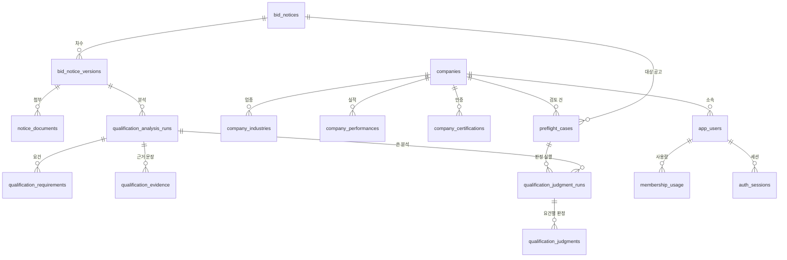

| 표 | 역할 |
| --- | --- |
| `bid_notices` · `bid_notice_versions` | 공고와 차수. 변경공고는 새 차수로 쌓입니다. |
| `notice_documents` | 첨부 문서의 추출문 · 블록 · 해시 |
| `qualification_analysis_runs` · `_requirements` · `_evidence` | LLM이 구조화한 요건과 근거 문장 |
| `preflight_cases` | 회사가 공고를 검토하는 단위(기준 차수 · 현재 차수) |
| `qualification_judgment_runs` · `_judgments` | 판정 실행과 요건별 결과, 당시의 회사 프로필 스냅샷 |
| `companies` · `company_*` | 회사 프로필 |
| `app_users` · `auth_sessions` · `membership_usage` | 계정 · 세션 · 요금제 사용량 |

---

## 📚 7. 시스템 구성도와 주요 처리 흐름

### 7.1 시스템 구성도

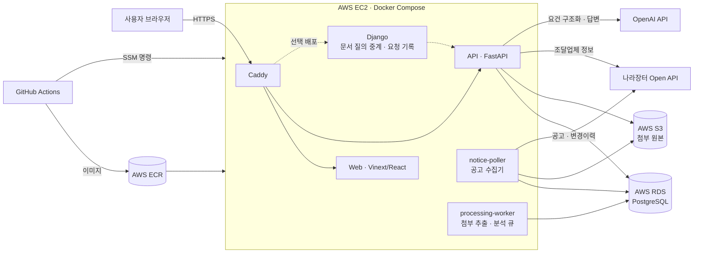

- 구조화 데이터는 RDS, 첨부 원본은 비공개 S3에 둡니다. EC2에는 DB 컨테이너가 없습니다.
- Django는 선택 배포입니다. 공고문 질문 요청을 받아 로그인을 확인하고 FastAPI로 넘기며, 요청 기록(질문 원문 없이 길이 · 해시 · 소요 시간)을 자체 DB에 남깁니다. 기본 배포에는 들어 있지 않습니다.
- 비밀 값은 AWS SSM Parameter Store에 두고 배포할 때 EC2에서 읽습니다. GitHub와 이미지에는 장기 키가 없습니다(OIDC 역할 사용).
- 배포 순서: 이미지 받기 → **스키마 · TLS 검사** → 서비스 교체 → HTTPS 상태 확인. 실패하면 이전 이미지로 되돌립니다.

### 7.2 엔진 구조

엔진(`engine/bidengine`)은 DB와 API를 import하지 않습니다. 같은 엔진을 API와 측정 도구가 함께 씁니다.

```
web ──(HTTP)──> api ──> engine <── eval(골든 회귀 · 표본 측정)
                 │
                 └──> db
```

| 단계 | 모듈 | 하는 일 |
| --- | --- | --- |
| 문서 | `document/` | 원문 블록, 청킹 |
| 추출 | `labeling/` | LLM 요건 추출, 업종 · 품명 코드 풀기 |
| 정리 | `requirements/` | 표준 형태 변환, 중복 제거 |
| 근거 | `grounding/` | 인용 문장과 문서의 연결 |
| 판정 | `judgment/` | 결정론적 규칙, 판정 불가 조건 가드 |
| 비교 | `diff/` | 차수 비교 |
| 검색 | `rag/` | 문서 청크 저장소, 검색, 근거 답변 |

### 7.3 판정 흐름

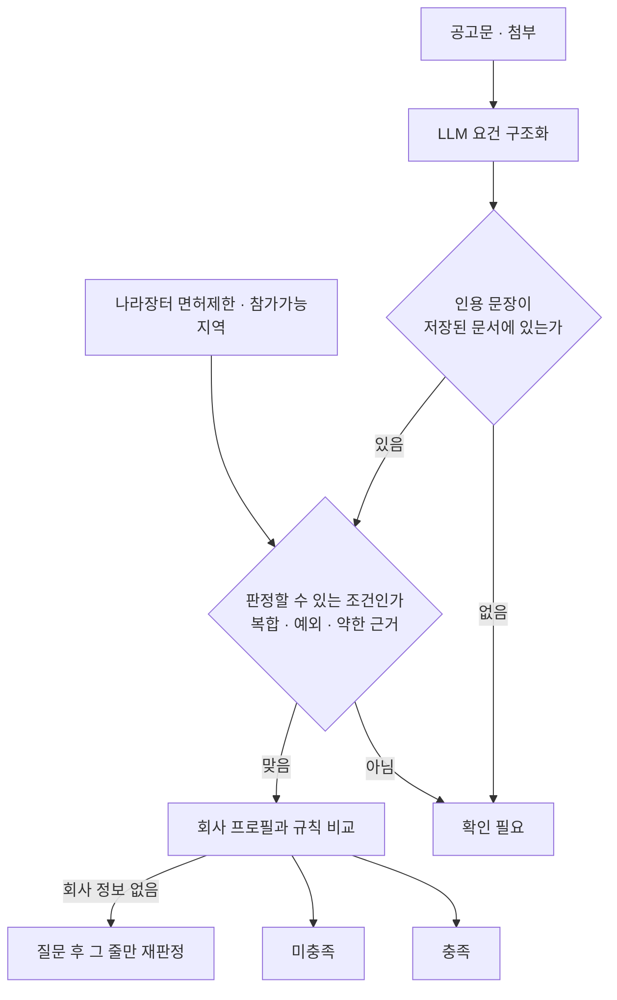

- **근거 확인을 통과한 요건만** 회사 프로필과 비교합니다. 인용 문장이 문서에 없거나 문서가 바뀌었으면 판정하지 않습니다.
- 이름만으로 맞춘 것처럼 근거가 약하면 "미충족"으로 확정하지 않고 "확인 필요"로 남깁니다. 자격 있는 회사를 부적격으로 만드는 오류가 가장 비싸기 때문입니다.
- 종합 판정은 업종코드 · 소재지 · 기업 구분 · 품명번호 같은 **닫힌 값**의 핵심 자격으로만 냅니다.

### 7.4 AI Copilot (문서 기반 질의응답)

| 경로 | 근거 | 동작 |
| --- | --- | --- |
| 공고별 대화 | 판정 결과 요약 + 공고문에서 질문과 관련된 대목 | 답변과 함께 원문 근거를 보여 줍니다. 근거가 없으면 답하지 않습니다. |
| 변경 공고 대응 | 저장된 차수 비교 결과 | 무엇이 바뀌었고 무엇을 다시 확인해야 하는지 안내합니다. |
| 일반 도우미 | 사이트 안내 | 사용법과 입찰 일반 지식에 답합니다. 회사 정보와 판정은 전달하지 않습니다. |
| 공고 찾기 · 추천 공고 판정 | 공고 검색 · AI 추천 조회 | 모델을 부르지 않고 공고를 찾아 판정 화면으로 이어 줍니다. |

- 처음 쓸 때 "회사 정보가 외부 API로 전달될 수 있다"는 안내를 확인해야 질문할 수 있습니다.
- 질문은 요금제 한도 안에서 셉니다(무료: 공고마다 6회 · 일반 도우미 월 10회, 베이직: 합쳐서 월 50회).

### 7.5 입찰 준비 지침서

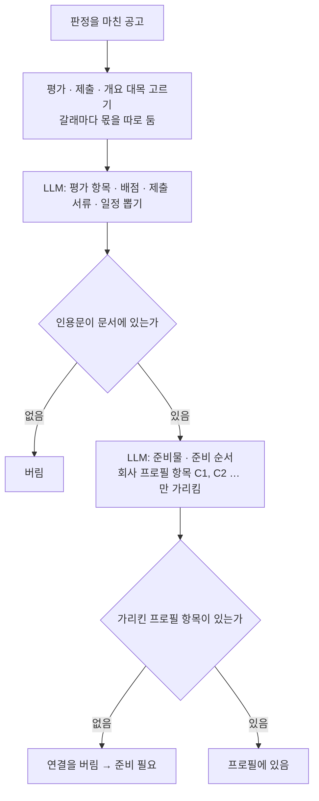

- 제안서 글을 대신 쓰지 않습니다. 처음에는 초안 생성기로 시험했지만, 회사 실적을 문장으로 쓰는 순간 지어낼 여지가 생겨 "무엇을 어떤 순서로 준비할지"를 정리하는 지침서로 바꿨습니다.
- 긴 제안요청서(15만 자)에서는 "요구사항"이 수백 번 나와 배점표가 발췌에서 빠졌습니다. 평가 · 제출 · 개요 대목의 몫을 따로 두어 배점표를 먼저 확보합니다.
- 한 번 만들 때 모델을 두 번 부르고, 그 공고의 Copilot 질문 1회로 셉니다. 결과는 서버에 저장하지 않고 브라우저에 둡니다.

---

## 🖥️ 8. 화면 설계

### 화면 흐름

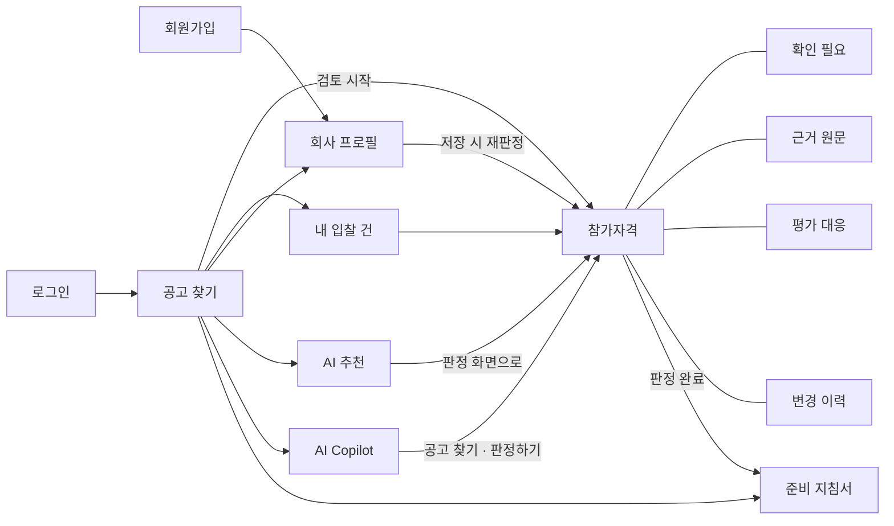

### 화면 목록

| 화면 | 경로 | 목적 | 주요 요소 |
| --- | --- | --- | --- |
| 로그인 | `/login` | 계정 인증 | 아이디 · 비밀번호, 회원가입 링크 |
| 회원가입 | `/signup` | 계정 만들기 | 아이디 · 비밀번호 · 확인, 규칙 안내 |
| 공고 찾기 | `/notices` | 공고 검색과 판정 상태 확인 | 판정 이력 카드, 검색 상자, 상태별 건수 타일, 사업 유형 필터, 공고 표, 이용 안내 |
| 내 입찰 건 | `/qualification` | 검토 중인 공고 목록 | 3×3 카드, 찾기 · 정렬, 변경공고 · 만료됨 표시, 마감일, 이번 달 확인 수 |
| 참가자격 | `/qualification?caseId=` | 공고의 판정 결과 | 변경 요약, 판정 요약, 핵심 자격 표, 확인할 항목, 공고 요약, 나라장터 원문 |
| 확인 필요 | `/ask-back` | 판정하지 못한 항목에 답하기 | 질문 카드, 답변 입력, 그 줄만 재판정 |
| 근거 원문 | `/evidence` | 판정과 공고문 대조 | 문서 본문, 요건별 근거 문장 |
| 평가 대응 | `/evaluation` | 제안서 평가 항목 확인 | 평가 항목, 제안서 내 위치 |
| 변경 이력 | `/changes` | 차수 사이의 변화 | 차수 카드, 기준 → 현재 비교 표, 판정 영향 |
| 회사 프로필 | `/company` | 판정에 쓰는 회사 정보 관리 | 사업자등록번호 조회, 업종 · 기본 정보 · 실적 · 인증, 한 번에 저장 |
| AI 추천 | `/recommendations` | 연관 공고 추천 | 추천 순위, 연관성 점수, 판정 화면으로 가기 |
| AI Copilot | `/copilot` | 문서 기반 질의응답 | 대화 목록(일반 도우미 · 공고별), 대화, 남은 질문 수 |
| 준비 지침서 | `/prep-guide` | 입찰 준비물과 순서 | 판정한 공고 목록, 준비 순서, 일정, 평가 항목별 준비물, 제출 서류 체크리스트 |
| 운영 관리 | `/admin` | 수집 · 처리 작업 관리 | 시스템 관리자 전용 |

모든 화면에는 떠 있는 둥근 메뉴 바(공고 검색 포함)와 오른쪽 아래의 AI Copilot 단추가 있습니다.

---

## ✅ 9. 수행결과 (테스트 및 시연 화면)

### 9.1 서비스 화면

| 공고 찾기 | 참가자격 판정 |
| --- | --- |
| 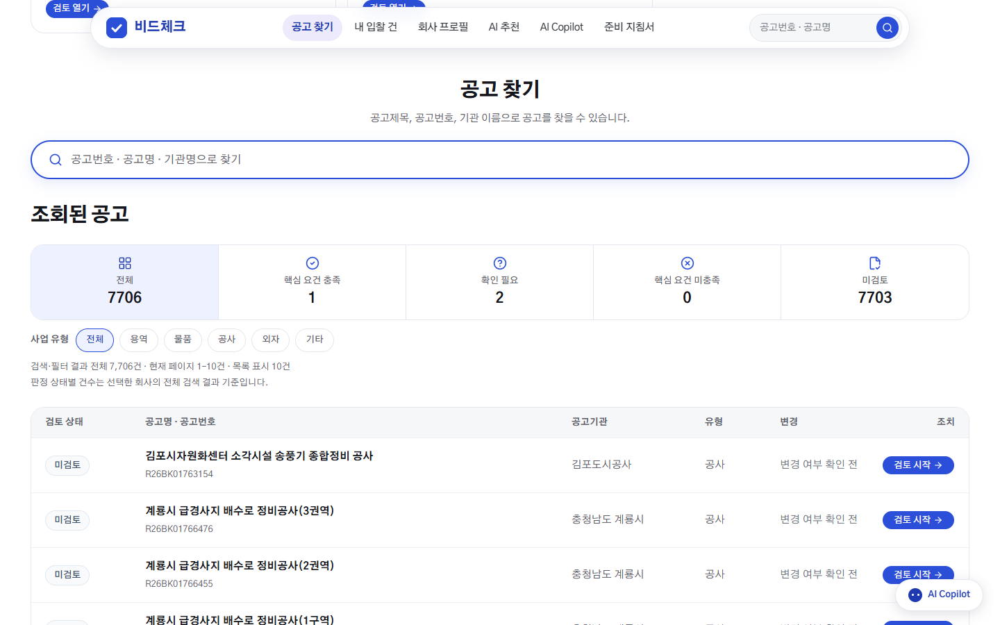 | 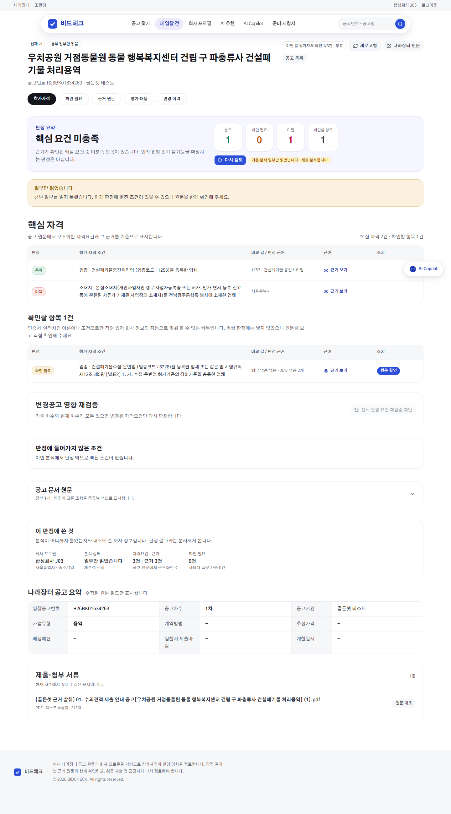 |
| 판정 상태별 건수와 공고 표 | 판정 요약 · 핵심 자격 · 확인할 항목 |

| 근거 원문 | 변경 이력 |
| --- | --- |
| 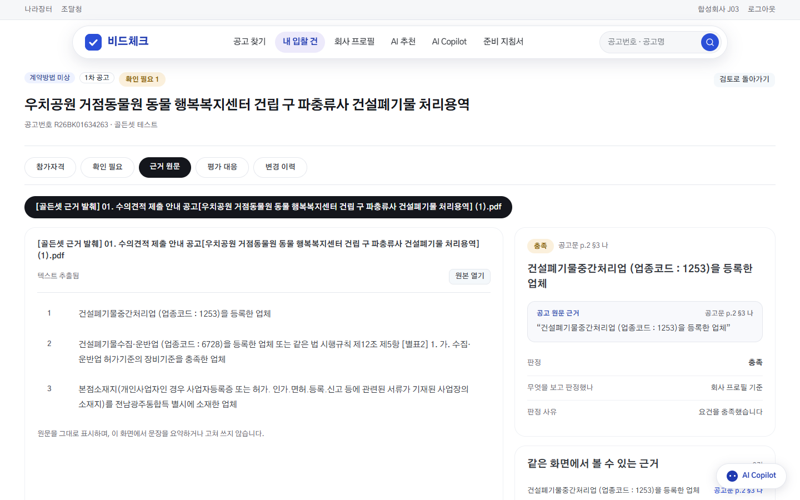 | 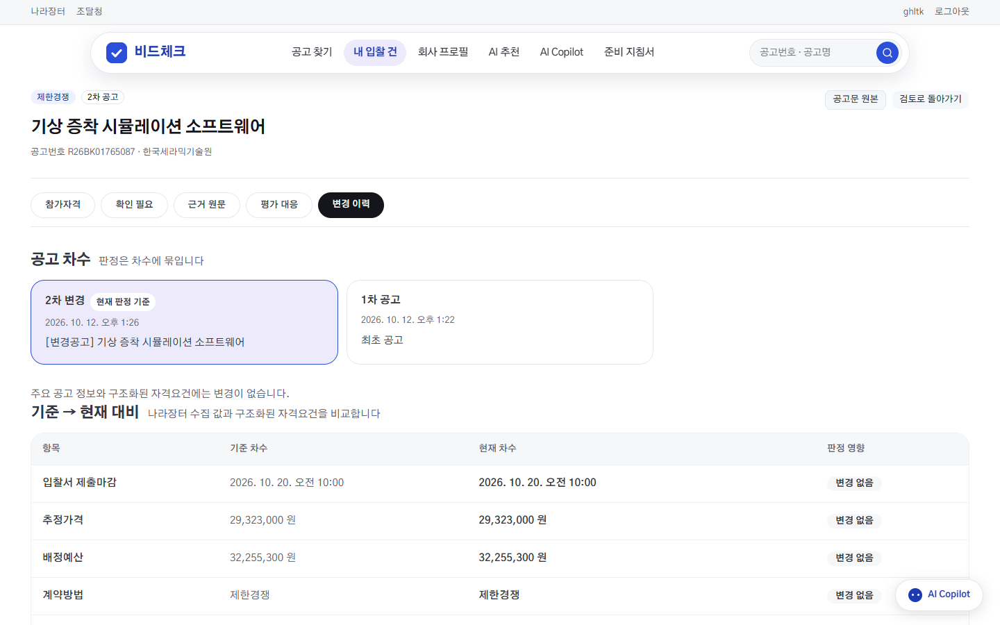 |
| 요건이 나온 문장과 판정 사유 | 차수별 공고 값 비교 |

| 회사 프로필 | AI Copilot — 공고 찾기 |
| --- | --- |
| 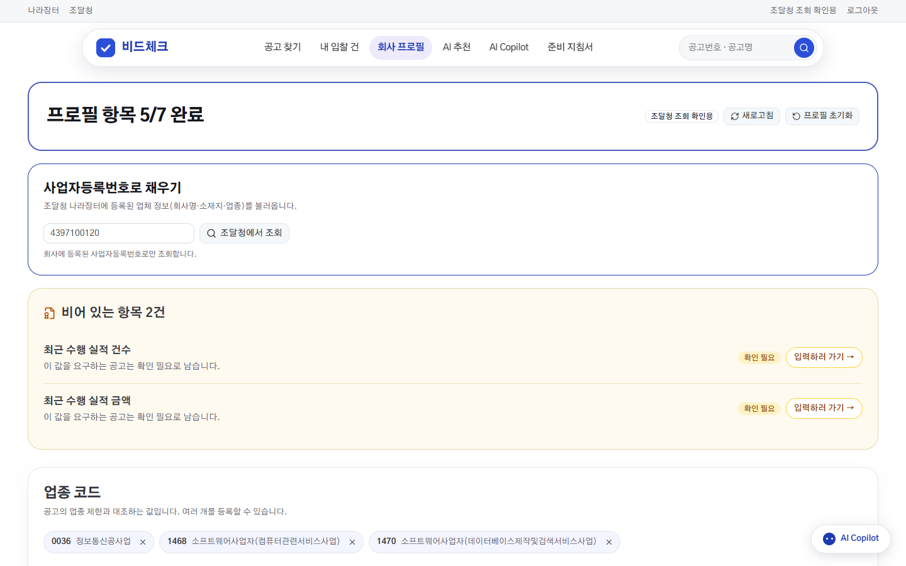 | 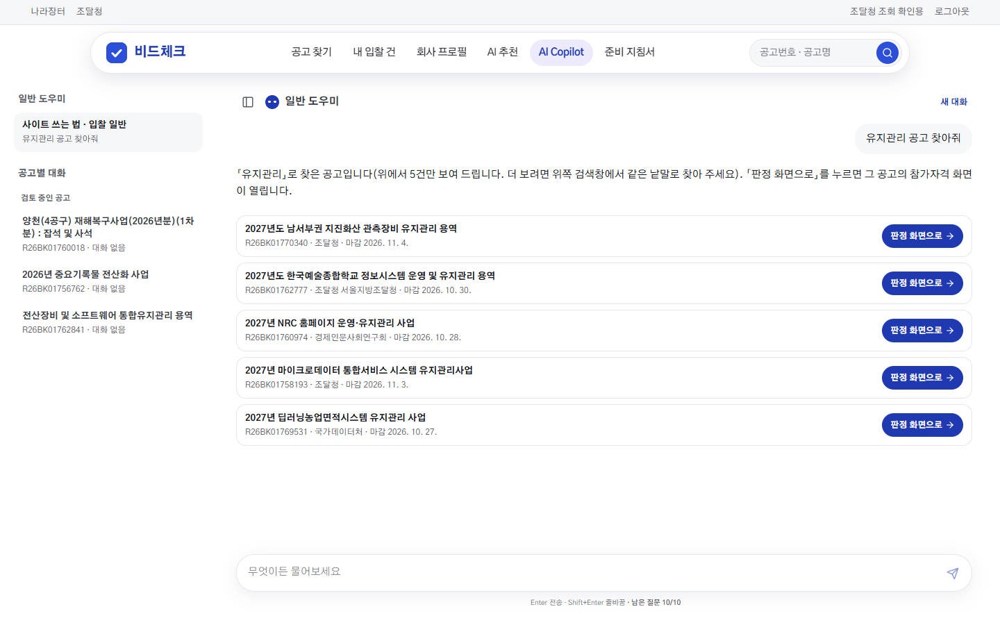 |
| 사업자등록번호로 조달청 정보 채우기 | 찾은 공고마다 판정 화면으로 가는 단추 |

| AI 추천 | 내 입찰 건 |
| --- | --- |
| 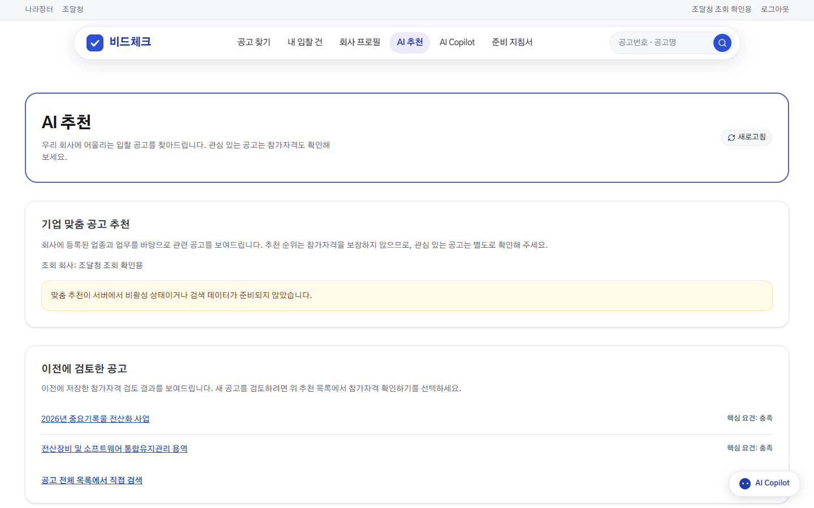 | 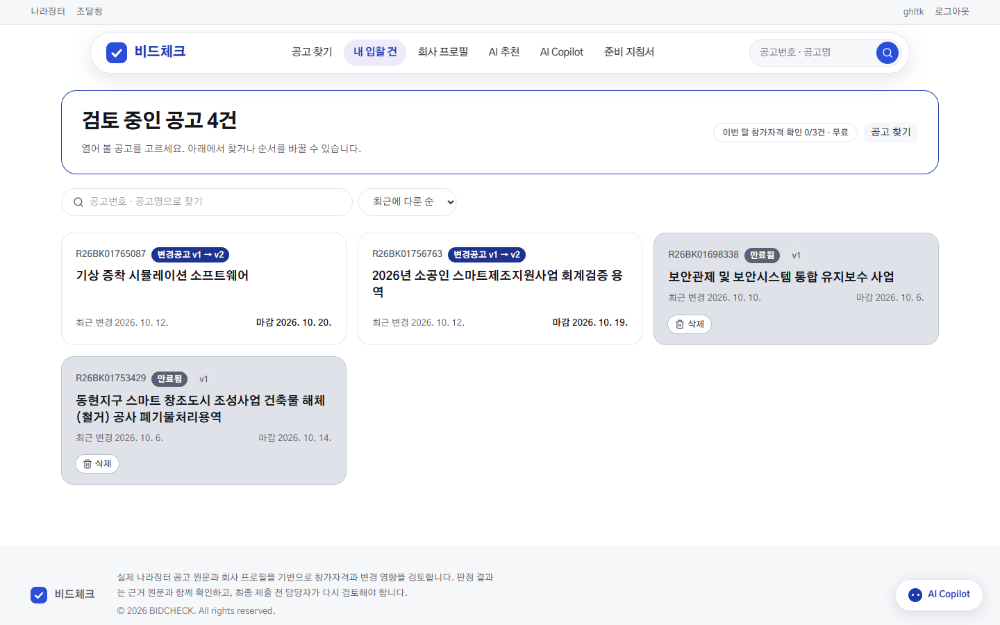 |
| 연관성 순위와 판정 상태 | 검토 중인 공고 카드, 만료됨 표시 |

| 입찰 준비 지침서 | 회원가입 |
| --- | --- |
| 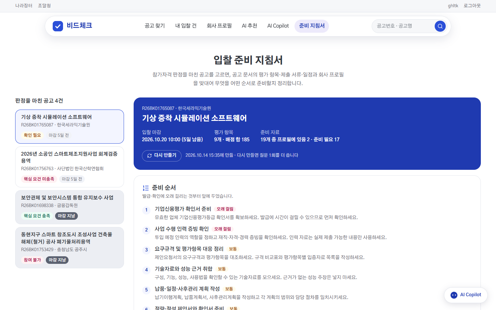 | 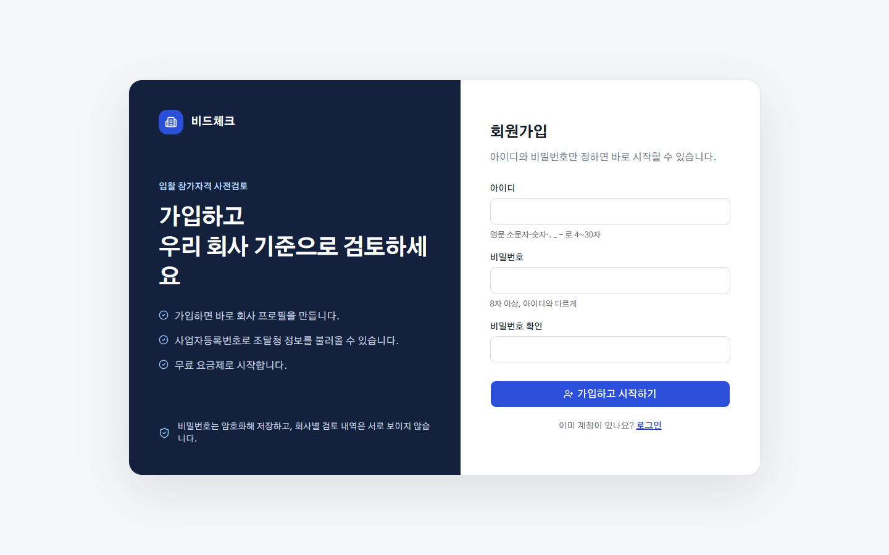 |
| 준비 순서 · 평가 항목별 준비물(프로필에 있음 / 준비 필요) | 아이디 · 비밀번호만으로 가입 |

| 로그인 | 멤버십(한도 초과) |
| --- | --- |
| 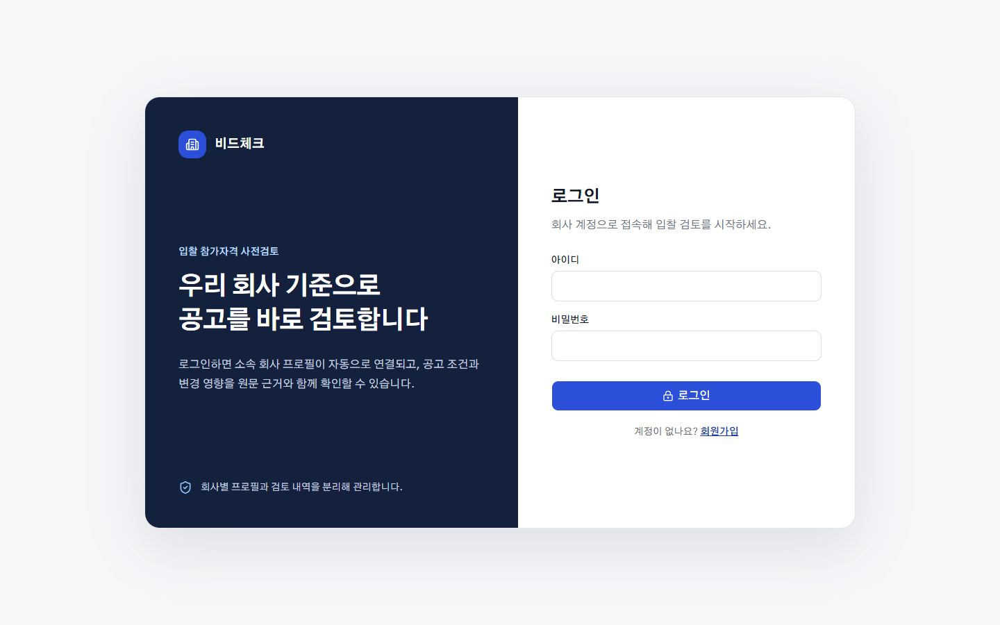 | 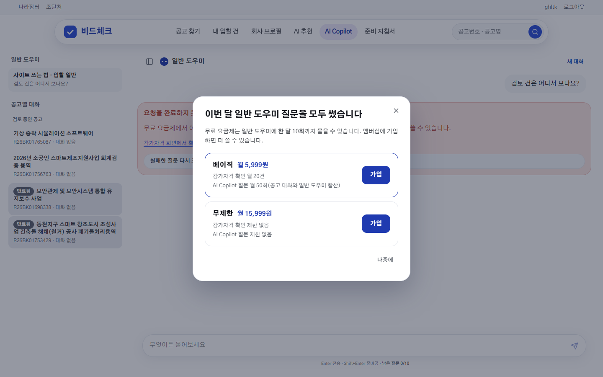 |

### 9.2 시연 시나리오

| 순서 | 동작 | 기대 결과 |
| --- | --- | --- |
| 1 | 회원가입(또는 회사 없는 계정으로 로그인) | 바로 로그인되어 회사 프로필 생성 화면이 나온다 |
| 2 | 사업자등록번호 입력 → 조달청에서 조회 → 채우기 → 저장 | 회사명 · 소재지 · 업종이 채워진다 |
| 3 | AI Copilot에 "유지관리 공고 찾아줘" | 공고 목록과 「판정 화면으로」 단추가 나온다 |
| 4 | 단추를 눌러 참가자격 화면으로 이동 → 검토 시작 | 요건별 판정과 근거 문장이 나온다 |
| 5 | 근거 보기 | 공고문에서 그 문장의 위치가 표시된다 |
| 6 | 공고 안에서 Copilot에 "입찰 마감이 언제야?" | 공고문 근거와 함께 답하고 남은 질문 수가 줄어든다 |
| 7 | 회사 프로필에 품명번호가 있는 인증 추가 → 저장 | 보던 공고를 다시 판정하고 결과를 알려 준다 |
| 8 | 네 번째 공고 검토 시작(무료 계정) | 멤버십 창이 뜬다 → 가입 → 한도가 늘어난다 |
| 9 | 변경공고 열기 | 달라진 값과 요건이 화면 맨 위에 나온다 |
| 10 | 준비 지침서에서 판정한 공고 고르기 → 지침서 만들기 | 준비 순서 · 일정 · 평가 항목별 준비물 · 제출 서류가 나온다 |
| 11 | 판정 화면의 「나라장터 원문」 | 새 창에 그 공고의 나라장터 상세가 열린다 |

### 9.3 테스트 계획

| 구분 | 대상 | 방법 | 도구 |
| --- | --- | --- | --- |
| 단위 테스트 | 엔진(추출 · 판정 · 차수 비교) | DB 없이 함수 단위 검증 | pytest |
| API 테스트 | 인증 · 공고 · 판정 · Copilot · 요금제 | 깨끗한 PostgreSQL에서 요청 단위 검증 | pytest · FastAPI TestClient |
| 판정 회귀 | 판정 규칙 | 골든셋 v0.2(공고 20건 · 회사 입력 32세트)의 기대값과 비교, 게이트 적용 | 골든 회귀 실행기 |
| 실제 공고 측정 | 추출 + 판정 전체 | 정답을 붙인 공고 표본으로 틀린 충족 · 틀린 미충족 검사 | 회귀 탐침 |
| 웹 단위 테스트 | 화면 로직 | 함수 단위 검증 | node:test |
| 브라우저 E2E | 로그인 · 화면 이동 · 캐시 · 권한 | 모의 API로 실제 브라우저 구동 | Playwright |
| 통합 테스트 | Copilot 전체 흐름 | 컨테이너를 띄워 화면과 API를 함께 검증 | Docker · Playwright |
| 배포 검증 | 스키마 · TLS · 상태 확인 | 배포 스크립트의 게이트 | deploy.sh |

### 9.4 테스트 결과

**자동 테스트 (PR마다 실행)**

| 검사 | 범위 | 테스트 수 |
| --- | --- | --- |
| engine | 엔진 단위 테스트 | 626 |
| eval | 측정 도구 테스트 + 골든 회귀 게이트 | 63 |
| backend | API 테스트 | 1,022 |
| frontend | 타입 검사 · lint · 단위 47 · 브라우저 E2E 23 | 70 |
| integration | 컨테이너를 띄운 Copilot 통합 검증 | 브라우저 · API 검증 스크립트 |
| django-qa | Django 시스템 · 마이그레이션 검사, 문서 질의 중계 테스트 | Django test |

**판정 정확도**

| 측정 | 결과 | 비고 |
| --- | --- | --- |
| 골든 회귀 — 기대값 일치 | **105 / 138** | 회귀 기준선 |
| 골든 회귀 — 안전한 보류 | **33 / 138** | 판정하지 않고 "확인 필요"로 남긴 행 |
| 골든 회귀 — 잘못된 확정 판정 | **0** | 게이트 |
| 실제 공고 표본 — 핵심 요건 | **192 / 198** | 정답 104건 기준 |
| 실제 공고 표본 — 틀린 충족 · 틀린 미충족 | **0** | |
| 제품 경로와 엔진 결과 일치 | **104 / 104** | 골든 계정 32개로 화면 경로에서 판정 |

**기능 확인 (브라우저, 로컬)**

| 항목 | 결과 |
| --- | --- |
| 무료 계정이 공고 3건 판정 후 네 번째에서 멤버십 창 | 통과 |
| 멤버십 코드로 베이직 적용, 가입 요청에 카드 번호 미포함 | 통과 |
| Copilot 남은 질문 6/6 → 5/6, 한도 도달 시 멤버십 창 | 통과 |
| 사업자등록번호 조회 → 프로필 반영 | 통과 |
| 프로필 한 번에 저장 → 보던 공고 자동 재판정 | 통과 |
| 만료 공고 표시 · 삭제, 마감 전 공고 삭제 거절(409) | 통과 |
| 계정을 바꾸면 다른 계정의 대화가 보이지 않음 | 통과 |
| "…공고 찾아줘" → 판정 화면 이동 | 통과 |
| 회원가입 → 바로 로그인 → 회사 생성 화면, 같은 아이디 거절 | 통과 |
| 준비 지침서 생성(약 30초), 동의 전 단추 비활성, 새로고침 뒤 유지 | 통과 |
| 긴 제안요청서 2건에서 평가 항목 14개씩 추출(이전 시험에서는 0개 · 1개) | 통과 |
| 판정 화면 「나라장터 원문」 → 같은 공고의 나라장터 상세 | 통과 |

---

## 🔑 트러블슈팅

| 문제 | 원인 | 해결 |
| --- | --- | --- |
| 자격 있는 회사가 "미충족"으로 나옴 | 서술형 조항에서 뽑은 이름("제조", "이에 준하는")을 회사 인증 목록과 문자열로 비교 | 이름으로 요구한 것은 목록에 없다고 미충족으로 확정하지 않고 "확인 필요"로 남김. 번호로 요구한 것만 닫힌 비교 |
| 표지 제목이 "제 제 제 … 안 안 안"으로 추출됨 | 그림자 효과가 걸린 글자가 PDF 안에 어긋난 자리로 18번씩 그려져 있음 | 같은 글자가 같은 크기로 거의 같은 자리에 다시 나오면 사본으로 보고 제거. 저장된 PDF 60개(683쪽) 중 21쪽이 바뀌고 사라진 글자는 없음 |
| 번호를 넣어도 직접생산확인 요건이 "확인 필요" | 화면의 번호 칸과 판정이 보는 칸이 서로 다른 열 | 품명번호 · 인증 코드 입력란을 추가해 판정이 보는 값을 넣을 수 있게 함 |
| 실적 · 인증을 추가해도 화면에 안 보임 | 추가 후에 회사 프로필 조회 캐시(90초)를 비우지 않음 | 변경 요청이 끝나면 캐시를 비움 |
| 다른 계정의 대화가 보임 | 브라우저 저장 칸 하나를 모든 계정이 같이 씀 | 저장 칸을 계정 id로 나누고, 계정이 바뀌면 화면의 대화를 비움 |
| 골든 계정의 판정이 전부 "확인 필요" | 골든 공고에 공고문 문서가 없어 근거 확인을 통과하지 못함 | 근거 발췌 문서를 함께 넣고 문서 해시를 근거에 기록 |
| 배포가 스키마 검사에서 멈춤 | 코드는 새 마이그레이션을 요구하는데 DB에는 적용 전 | 의도한 동작. 검사가 막고 이전 버전으로 되돌림. 마이그레이션 적용 후 다시 배포 |
| 병합했는데 AWS에 반영되지 않음 | CI가 테스트용 DB 이미지를 받다 저장소 다운로드 한도(`toomanyrequests`)에 걸려 실패 → CI 성공을 조건으로 하는 배포가 건너뜀 | 코드 문제가 아니라 실패한 작업만 다시 실행. CI 통과 후 배포가 자동으로 이어짐 |
| 지침서가 평가 항목을 못 찾음 | 15만 자 제안요청서에서 낱말 개수로 대목을 고르니 "요구사항"이 많은 구간만 뽑히고 배점표가 빠짐 | 평가 · 제출 · 개요 대목의 몫을 따로 두고 hwp · pdf 중복 첨부는 한 번만 읽음 |
| 업종 검색에 같은 이름이 두 번 나옴 | 테스트 준비 자료의 가짜 코드(`0004 정보통신공사업`)가 로컬 DB에 남음 | 조달청 업종 목록 2,916개와 대조해 가짜 코드를 지움(진짜는 `0036`) |

---

## 📈 현재 한계와 다음 개선

**현재 한계**

- 실적 · 인증처럼 이름으로 적힌 조건은 자동으로 확정하지 않습니다. "확인할 항목"으로 남기고 담당자가 봅니다.
- 요금제의 결제는 붙어 있지 않습니다. 멤버십 코드로 가입하는 시연용 흐름입니다.
- AI 추천은 학습 모델 없이 낱말 겹침 방식으로 동작합니다.
- 조달청 조회는 나라장터에 입찰참가자격을 등록한 업체만 됩니다.
- 준비 지침서는 서버에 저장하지 않아 다른 기기에서는 다시 만들어야 합니다. 제안요청서가 첨부되지 않은 공고는 평가 항목 없이 일정 · 제출 서류만 나옵니다.
- 회원가입에 요청 횟수 제한과 이메일 인증이 없습니다. 공개 서비스로 열 때는 필요합니다.

**다음 개선**

- 준비 지침서 저장과 공유(팀원이 같은 지침서를 보고 체크리스트를 함께 채우기)
- 복합 조건(둘 중 하나 · 예외 단서)의 판정 범위 확대
- AI 추천의 학습 모델 적용과 사람 검수 라벨 축적
- 변경공고 알림

---

## 💬 10. 한 줄 회고

**김재현**

(작성 예정)

**이홍규**

(작성 예정)

**전진환**

(작성 예정)

**정예린**

(작성 예정)

**황수빈**

(작성 예정)
